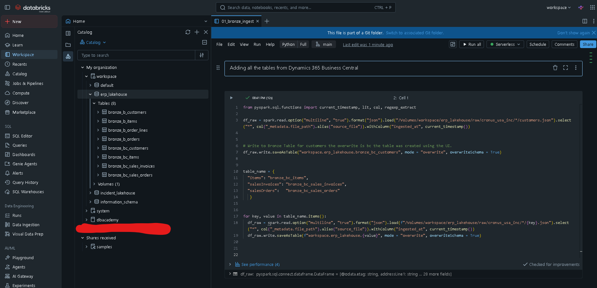

# ERP Lakehouse on Databricks

I'm combining ERP data from two companies in one Databricks lakehouse. Company A runs Business Central (CRONUS USA, Inc. demo data). Company B is an acquired business whose old system only exports CSV files.

## Status
- [x] Business Central extract (customers, items, sales orders, sales invoices)
- [x] Company B customers, items, and 5 days of orders with planted data problems
- [x] Raw files uploaded to a Databricks volume
- [x] Bronze layer
- [ ] Silver, quality checks, dashboard

## How It Works
1. A Python script pulls Business Central data through its API and saves JSON files.
2. Python scripts generate Company B's messy CSV files.
3. The Databricks CLI copies both into the volume `workspace.erp_lakehouse.raw`.
4. Notebooks load them into bronze, silver and gold.

The extract runs on my laptop because Databricks Free Edition blocks most outside websites.

## Raw Volume Layout
```
/Volumes/workspace/erp_lakehouse/raw/
  cronus_usa_inc/<extract date>/   customers, items, salesOrders, salesInvoices (JSON)
  company_b/
    customers.csv
    items.csv
    2026-10-26/ to 2026-10-30/    orders.csv, order_lines.csv
```
Note: locally, the Business Central files are saved in `data/business_central`. In the volume, that folder is named `cronus_usa_inc`, after the demo company.

## How the Company B Data Is Generated
- `faker_customers_gen.py` uses Faker to make 40 customers, plus Alpine Ski House as B-9000.
- `items_gen.py` builds 25 items and borrows 3 real products from the Business Central extract.
- `orders_gen.py` reads the customers and items, then writes 5 days of orders and order lines.

## Planted Data Problems
Company B's data has problems on purpose, so I can find and fix them in silver.

| Problem | File |
|---|---|
| Alpine Ski House is B-9000 in Company B and 40000 in Business Central | customers.csv |
| 3 products have different part numbers in each company | items.csv |
| One duplicate part number with two prices | items.csv |
| Units spelled `EA`, `ea` and `Each` | items.csv |
| Mixed date formats (`2026-10-26` and `10/26/2026`) | orders.csv |
| Orders with a blank customer ID | orders.csv |
| Order lines pointing to orders that don't exist | order_lines.csv |
| Short file: only a third of the orders on Oct 28 | orders.csv |
| Missing file: no orders on Oct 29 | orders.csv |

## Bronze Layer
`01_bronze_ingest` loads every raw file into a Delta table as-is, in `workspace.erp_lakehouse`:

| Business Central | Company B |
|---|---|
| bronze_bc_customers | bronze_b_customers |
| bronze_bc_items | bronze_b_items |
| bronze_bc_sales_orders | bronze_b_orders |
| bronze_bc_sales_invoices | bronze_b_order_lines |

- Business Central JSON is read with `multiLine`, since each file is one array.
- Company B CSVs are read as text (`inferSchema` off), so the messy values come through unchanged.
- Every table has `source_file` and `ingested_at`. Company B orders and order lines also have `file_date`, taken from the folder name.

Orders by `file_date` show the planted problems landed: Oct 28 is short, and Oct 29 is missing.



## Repo Structure
```
dynamics365_bc_extract/dynamics365_bc_extract.py   Business Central extract (CRONUS USA, Inc.)
src/faker_customers_gen.py                         Company B customers
src/items_gen.py                                   Company B items
src/orders_gen.py                                  Company B orders and order lines
databricks_notebook/01_bronze_ingest               Bronze tables
data/                                              Output files (gitignored, not committed)
```

## What I Learned
- My customer script first used a relative path, so it only worked from the repo root and crashed on a fresh clone because the folder didn't exist. I switched it to a path based on the script's location and had it create the folder before saving.
- I moved all of Company B's files into one `company_b` folder, so each source lives in its own place locally and in the volume.
- Reading the CSVs with `inferSchema` off keeps bronze faithful to the source. Type guessing would have hidden the mixed date formats.

## Next Steps
1. Add load checks: missing file, short file, blank customer IDs, orphan lines
2. Build silver: fix dates, units and duplicates, and match customers and products
3. Add a dashboard