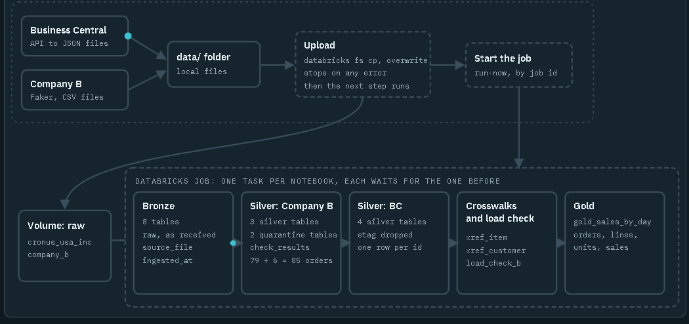

# ERP Lakehouse on Databricks

I'm combining ERP data from two companies in one Databricks lakehouse. Company A runs Business Central (CRONUS USA, Inc. demo data). Company B is an acquired business whose old system only exports CSV files.

## Status
- [x] Business Central extract (customers, items, sales orders, sales invoices)
- [x] Company B customers, items, and 5 days of orders with planted data problems
- [x] Raw files uploaded to a Databricks volume
- [x] Bronze layer
- [x] Silver layer for both companies, with quarantine tables for Company B
- [x] Crosswalk tables, daily load check, and row count log
- [x] Gold: sales by day for Company B
- [ ] Combined gold view of both companies, dashboard

## How It Works
1. A Python script pulls Business Central data through its API and saves JSON files.
2. Python scripts generate Company B's messy CSV files.
3. The Databricks CLI copies both into the volume `workspace.erp_lakehouse.raw`.
4. Notebooks load them into bronze, silver and gold.

The extract runs on my laptop because Databricks Free Edition blocks most outside websites.

## Raw Volume Layout
```
/Volumes/workspace/erp_lakehouse/raw/
  cronus_usa_inc/<extract date>/   customers, items, salesOrders, salesInvoices (JSON)
  company_b/
    customers.csv
    items.csv
    2026-10-26/ to 2026-10-30/    orders.csv, order_lines.csv (no orders.csv on Oct 29)
```
Note: locally, the Business Central files are saved in `data/business_central`. In the volume, that folder is named `cronus_usa_inc`, after the demo company.

## How the Company B Data Is Generated
- `faker_customers_gen.py` uses Faker to make 40 customers, plus Alpine Ski House as B-9000.
- `items_gen.py` builds 25 items and borrows 3 real products from the Business Central extract.
- `orders_gen.py` reads the customers and items, then writes 5 days of orders and order lines.

## Planted Data Problems
Company B's data has problems on purpose, so I can find and fix them in silver.

| Problem | File |
|---|---|
| Alpine Ski House is B-9000 in Company B and 40000 in Business Central | customers.csv |
| 3 products have different part numbers in each company | items.csv |
| One duplicate part number with two prices | items.csv |
| Units spelled `EA`, `ea` and `Each` | items.csv |
| Mixed date formats (`2026-10-26` and `10/26/2026`) | orders.csv |
| Orders with a blank customer ID | orders.csv |
| Order lines pointing to orders that don't exist | order_lines.csv |
| Short file: only a third of the orders on Oct 28 | orders.csv |
| Missing file: no orders on Oct 29 | orders.csv |

## Bronze Layer
`01_bronze_ingest` loads every raw file into a Delta table as-is, in `workspace.erp_lakehouse`:

| Business Central | Company B |
|---|---|
| bronze_bc_customers | bronze_b_customers |
| bronze_bc_items | bronze_b_items |
| bronze_bc_sales_orders | bronze_b_orders |
| bronze_bc_sales_invoices | bronze_b_order_lines |

- Business Central JSON is read with `multiLine`, since each file is one array.
- Company B CSVs are read as text (`inferSchema` off), so the messy values come through unchanged.
- Every table has `source_file` and `ingested_at`. All Company B tables also have `file_date`, taken from the folder name. It is blank for customers and items, since those files are not in a dated folder.

Orders by `file_date` show the planted problems landed: Oct 28 is short, and Oct 29 is missing.


## Silver Layer: Company B
`02_silver_clean` cleans Company B's data and sets aside rows that fail a check:

| Table | What it does |
|---|---|
| silver_b_items | Units standardized to `EA`, prices cast to decimal, duplicate part number removed by keeping the higher price |
| silver_b_orders | Order and ship dates parsed from both formats into real dates |
| silver_b_order_lines | Quantity and price cast to numbers, and only lines whose order is in silver orders |
| quarantine_b_orders | Orders with a missing customer ID or an invalid order date, with a `reject_reason` |
| quarantine_b_order_lines | Rejected order lines, with a `reject_reason` |

- Bad rows are set aside with a reason and never deleted. Silver rows plus quarantine rows equal the bronze row count.
- If a row count check fails, `check_results` gets a row with the date, the tables and all three counts, and the notebook keeps running with a warning.
- Orders: 79 valid and 6 quarantined, out of 85.
- Order lines: 205 valid and 117 quarantined, out of 322. Every quarantined line has the reason "order not in silver orders", mostly from Oct 28 and Oct 29, since their orders never arrived.

## Silver Layer: Business Central
The Business Central data is clean demo data, so its silver step is light. It drops the `@odata.etag` column, removes duplicate ids by keeping the newest row, and saves four tables: `silver_bc_customers`, `silver_bc_items`, `silver_bc_sales_orders` and `silver_bc_sales_invoices`. Row counts match bronze (5, 80, 20 and 305), so there were no duplicates.

## Crosswalks
`03_crosswalks_and_load_check` maps Company B IDs to Business Central IDs:

- `xref_item` is built by matching item descriptions. Both names are cleaned (lowercase, no punctuation), matched exactly, then fuzzy matched with edit distance and a cutoff of 0.8. All 3 planted items matched exactly with a score of 1, and the fuzzy step found no extra matches.
- `xref_customer` holds the one planted customer, B-9000 to 40000, and is maintained by hand.

## Load Check
The same notebook builds the list of expected days from the earliest and latest `file_date` in bronze, then compares row counts per day. Results are saved in `load_check_b`:

| file_date | orders | lines | status |
|---|---|---|---|
| 2026-10-26 | 30 | 86 | OK |
| 2026-10-27 | 20 | 44 | OK |
| 2026-10-28 | 8 | 62 | LOW VOLUME |
| 2026-10-29 | 0 | 59 | MISSING ORDERS FILE |
| 2026-10-30 | 27 | 71 | OK |

The expected range comes from the data, so a missing last day would not be caught. A production version would take it from a schedule.

## Gold Layer
`04_gold-sales` joins silver orders to silver order lines and builds `gold_sales_by_day`: order count, line count, total units and total sales per day. Oct 28 is low and Oct 29 is missing, because of the quarantined rows above. I can trace both back through the quarantine tables and the load check.

## Tables
22 tables in `workspace.erp_lakehouse`:

| Layer | Tables |
|---|---|
| Bronze (8) | bronze_bc_customers, bronze_bc_items, bronze_bc_sales_orders, bronze_bc_sales_invoices, bronze_b_customers, bronze_b_items, bronze_b_orders, bronze_b_order_lines |
| Silver (7) | silver_b_items, silver_b_orders, silver_b_order_lines, silver_bc_customers, silver_bc_items, silver_bc_sales_orders, silver_bc_sales_invoices |
| Quarantine (2) | quarantine_b_orders, quarantine_b_order_lines |
| Checks (2) | check_results, load_check_b |
| Crosswalks (2) | xref_customer, xref_item |
| Gold (1) | gold_sales_by_day |

## Repo Structure
```
dynamics365_bc_extract/dynamics365_bc_extract.py   Business Central extract (CRONUS USA, Inc.)
src/faker_customers_gen.py                         Company B customers
src/items_gen.py                                   Company B items
src/orders_gen.py                                  Company B orders and order lines
databricks_notebook/01_bronze_ingest               Bronze tables
databricks_notebook/02_silver_clean                Silver and quarantine tables for Company B
databricks_notebook/02b_silver_business_central    Silver tables for Business Central
databricks_notebook/03_crosswalks_and_load_check   Crosswalks and daily load check
databricks_notebook/04_gold-sales                  Gold sales by day
data/                                              Output files (gitignored, not committed)
```

## What I Learned
- My customer script first used a relative path, so it only worked from the repo root and crashed on a fresh clone because the folder didn't exist. I switched it to a path based on the script's location and had it create the folder before saving.
- I moved all of Company B's files into one `company_b` folder, so each source lives in its own place locally and in the volume.
- Reading the CSVs with `inferSchema` off keeps bronze faithful to the source. Type guessing would have hidden the mixed date formats.
- Casting with `try_cast` and `try_to_date` returns null for a bad value instead of crashing the notebook, so I can catch bad rows and set them aside.
- A row count check after each split catches silently lost rows. I log failures to a table instead of stopping the notebook.
- My first load check used a hardcoded date range, which would never notice a new batch. Building the range from the data fixed that, but it still cannot see a missing last day.
- Matching items by description found the Paris Guest Chair as `1900-S`. I had guessed a different number from memory, so I stopped typing mappings by hand.

## Next Steps
1. Build a combined gold view of both companies, using the crosswalks
2. Flag order lines with no item match as unmapped
3. Add a dashboard